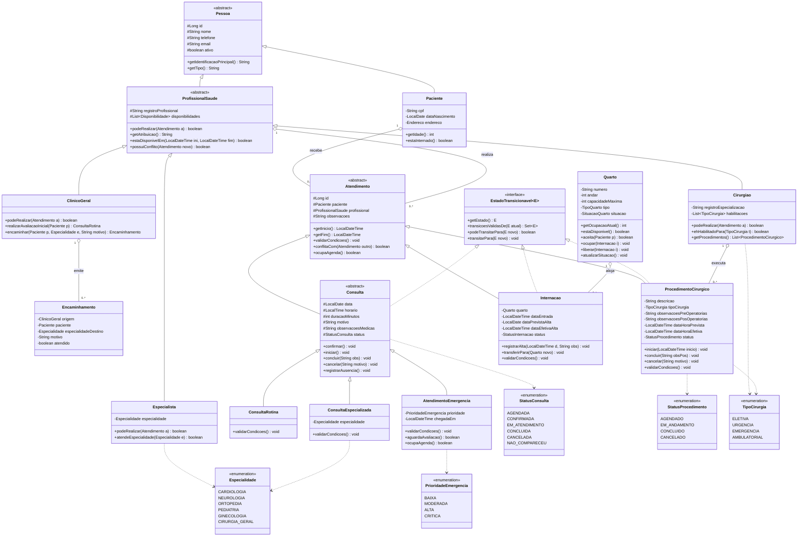
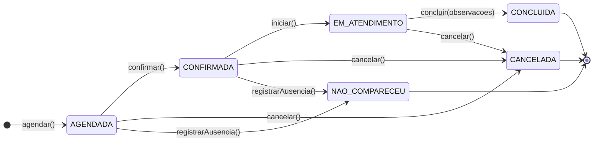
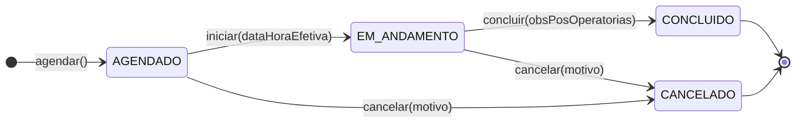

# Vitalis — Diagrama de Classes

**PUC Minas · Engenharia de Software · Programação Modular**
Sprint 2 — Implementação da API e Modelo

Este documento é o **contrato do domínio**: é nele que as assinaturas ficam acordadas antes de as três trilhas começarem a implementar em paralelo.

- [O que mudou desde a Sprint 1](#o-que-mudou-desde-a-sprint-1)
- [Modelo de domínio](#modelo-de-domínio)
- [Decisões de modelagem](#decisões-de-modelagem)
- [Máquinas de estado](#máquinas-de-estado)
- [Hierarquia de exceções](#hierarquia-de-exceções)
- [Rastreabilidade com o enunciado](#rastreabilidade-com-o-enunciado)

---

## O que mudou desde a Sprint 1

| Sprint 1 | Sprint 2 |
|---|---|
| `ProfissionalSaude` concreta, com um campo `especialidade` | `ProfissionalSaude` **abstrata** → `ClinicoGeral`, `Especialista`, `Cirurgiao` |
| `Atendimento` → `Consulta`, `Internacao` | `Atendimento` → `Consulta` (abstrata), `ProcedimentoCirurgico`, `Internacao` |
| — | `Consulta` → `ConsultaRotina`, `ConsultaEspecializada`, `AtendimentoEmergencia` |
| `StatusConsulta` com 4 valores, sem regra de transição | 6 estados com máquina de transições |
| — | `EstadoTransicionavel<E>`, `PrioridadeEmergencia`, `StatusProcedimento`, `TipoCirurgia`, `Encaminhamento` |
| `HistoricoMedico` com listas separadas por tipo | lista única de `Atendimento`, polimórfica |

**Sete classes novas**, duas abstrações novas e quatro enumerações novas.

---

## Modelo de domínio

> O diagrama acima omite `Endereco`, `Disponibilidade`, `RegistroClinico`, `HistoricoMedico` e as enumerações herdadas da Sprint 1, para caber na tela. A versão completa está em [`diagramas/01-dominio.mmd`](diagramas/01-dominio.mmd).

---

## Decisões de modelagem

### 1. `Consulta` abstrata entre `Atendimento` e as três modalidades

As três modalidades de consulta compartilham `data`, `horario`, `duracaoMinutos`, `motivo`, `observacoesMedicas` e — o que mais importa — **a máquina de seis estados**. Sem a abstrata no meio, essa máquina seria escrita três vezes.

É exatamente o que o enunciado proíbe:

> *"O sistema deverá representar essas características sem duplicar desnecessariamente os atributos e comportamentos comuns."*

**O incômodo:** um atendimento de emergência não é agendado — o paciente chega. Colocá-lo sob `Consulta` faz ele herdar `data` e `horario`, que nele significam *quando aconteceu*, não *quando foi marcado*.

Aceitamos esse incômodo porque a alternativa — emergência herdando direto de `Atendimento` — duplicaria status, observações e a máquina de estados inteira. `AtendimentoEmergencia` sobrescreve `ocupaAgenda()` devolvendo `false`, e é assim que ele escapa da verificação de conflito de horário.

> **Ponto aberto para o grupo.** Se o Enzo ou o Armando discordarem, a hora de dizer é antes de a #8 começar.

### 2. `validarCondicoes()` é abstrato em `Atendimento`

É o método que o enunciado cobra nominalmente:

> *"Cada modalidade deverá implementar sua própria lógica de validação das condições necessárias para a realização do atendimento."*

| Modalidade | O que valida |
|---|---|
| `ConsultaRotina` | Profissional livre no horário e dentro da disponibilidade |
| `ConsultaEspecializada` | Tudo da rotina **mais** especialidade compatível |
| `AtendimentoEmergencia` | Nada de agenda — é imediato por natureza |
| `ProcedimentoCirurgico` | Responsável é `Cirurgiao` e está habilitado para o tipo |
| `Internacao` | Quarto disponível, com vaga, e paciente sem internação ativa |

### 3. `EstadoTransicionavel<E>` em vez de três máquinas de estado

Consulta tem 6 estados, procedimento tem 4, internação tem 4. São o mesmo padrão: um estado atual, um conjunto de transições válidas, e uma exceção quando se tenta o que não vale.

Uma interface genérica em `comum` resolve as três. Quem implementa declara apenas o mapa de transições permitidas; a validação e o lançamento de `TransicaoInvalidaException` acontecem num lugar só.

### 4. `podeRealizar(Atendimento)` polimórfico no profissional

Em vez de o serviço perguntar *"este profissional é um especialista? e a especialidade bate?"*, ele pergunta `profissional.podeRealizar(atendimento)`. Cada categoria responde por si:

- `ClinicoGeral` aceita consulta de rotina, recusa especializada e cirurgia
- `Especialista` aceita rotina e especializada **da sua área**
- `Cirurgiao` aceita procedimento cirúrgico do tipo para o qual está habilitado

Sem `instanceof` espalhado pela camada de serviço.

### 5. `Encaminhamento` como entidade

> *"Pode encaminhar pacientes para atendimento especializado."*

Encaminhar não é só chamar um método e esquecer — é um registro que alguém precisa consultar depois para marcar a consulta especializada. Vira entidade, com origem, paciente, especialidade de destino, motivo e se já foi atendido.

---

## Máquinas de estado

### Situação da consulta

As transições que o enunciado proíbe nominalmente:

> *"Uma consulta já concluída não deverá voltar a ser considerada agendada. Da mesma forma, uma consulta cancelada não deverá ser registrada como concluída sem que exista um novo agendamento."*

Ambas caem na regra geral: **`CONCLUIDA`, `CANCELADA` e `NAO_COMPARECEU` são estados finais.** Para reatender o paciente, agenda-se uma consulta nova.

> **Ponto aberto para o grupo.** O enunciado dá exemplos, não a tabela fechada. Esta tabela é uma proposta — confirmem antes de a #9 começar.

### Ciclo do procedimento cirúrgico

**Não existe seta de `AGENDADO` para `CONCLUIDO`.** É a invariante do enunciado:

> *"Não será permitido registrar um procedimento como concluído se ele não tiver sido iniciado."*

Isso é invariante do objeto, não validação de tela: `concluir()` recusa quando o estado não é `EM_ANDAMENTO`, mesmo que o controller esqueça de checar. É também `iniciar()` quem grava a `dataHoraEfetiva` — sem ela, não há o que concluir.

---

## Hierarquia de exceções

Fonte completa em [`diagramas/03-excecoes.mmd`](diagramas/03-excecoes.mmd).

| Exceção | HTTP | Quando |
|---|---|---|
| `RecursoNaoEncontradoException` | 404 | ID inexistente |
| `DadosInvalidosException` | 400 | Falha de validação de campo |
| `ConflitoDeHorarioException` | 409 | RN3 — profissional já ocupado no intervalo |
| `EspecialidadeIncompativelException` | 409 | Consulta especializada com profissional de outra área |
| `CirurgiaoNaoHabilitadoException` | 409 | Cirurgião sem habilitação para o tipo de cirurgia |
| `TransicaoInvalidaException` | 409 | Transição de estado proibida, em qualquer entidade |
| `QuartoIndisponivelException` | 409 | RN4 — quarto em manutenção ou interditado |
| `CapacidadeExcedidaException` | 409 | RN5 — quarto lotado |
| `PacienteJaInternadoException` | 409 | Paciente com internação ativa |
| `AltaInvalidaException` | 422 | Alta anterior à entrada, ou internação já encerrada |

Três das novas (`EspecialidadeIncompativel`, `CirurgiaoNaoHabilitado`, `TransicaoInvalida`) nascem direto das regras da Sprint 2.

---

## Rastreabilidade com o enunciado

| O enunciado pede | Onde está no modelo |
|---|---|
| Médico clínico geral com encaminhamento | `ClinicoGeral` + `Encaminhamento` |
| Especialista com área de atuação e busca por área | `Especialista.especialidade` + `GET /profissionais?especialidade=` |
| Cirurgião com registro de procedimentos | `Cirurgiao.getProcedimentos()` |
| Consulta de rotina | `ConsultaRotina` |
| Consulta especializada com profissional compatível | `ConsultaEspecializada.validarCondicoes()` |
| Emergência com prioridade e fila | `AtendimentoEmergencia` + `PrioridadeEmergencia` |
| Procedimento com pré e pós-operatório, previsto e efetivo | `ProcedimentoCirurgico` |
| Sem duplicar atributos e comportamentos comuns | `Pessoa`, `ProfissionalSaude`, `Atendimento`, `Consulta` abstratas |
| Cada modalidade valida suas condições | `validarCondicoes()` abstrato, sobrescrito em 5 classes |
| Seis situações da consulta | `StatusConsulta` + máquina de transições |
| Impedir alterações incompatíveis | `EstadoTransicionavel` + `TransicaoInvalidaException` |
| Sem valores textuais livres | 11 enumerações, nenhuma `String` de estado |
| Procedimento não conclui sem iniciar | Ausência da transição `AGENDADO → CONCLUIDO` |
| Tipos de quarto | `TipoQuarto` + `Quarto.aceita(Paciente)` — **regra ainda indefinida, ver [#12](https://github.com/GustavoAlbuquerquee/vitalis/issues/12)** |

---

## Arquivos

| Arquivo | Conteúdo |
|---|---|
| [`diagramas/01-dominio.mmd`](diagramas/01-dominio.mmd) | Domínio completo |
| [`diagramas/02-camadas.mmd`](diagramas/02-camadas.mmd) | Arquitetura em camadas |
| [`diagramas/03-excecoes.mmd`](diagramas/03-excecoes.mmd) | Hierarquia de exceções |
| [`diagramas/04-estados-consulta.mmd`](diagramas/04-estados-consulta.mmd) | Máquina de estados da consulta |
| [`diagramas/05-estados-procedimento.mmd`](diagramas/05-estados-procedimento.mmd) | Ciclo do procedimento cirúrgico |
| [`diagramas/dominio.puml`](diagramas/dominio.puml) | Domínio em PlantUML |
| [`diagramas/diagrama-classes.html`](diagramas/diagrama-classes.html) | Versão renderizada, com zoom e download em `.svg` |
