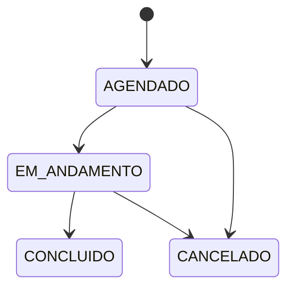

# Módulo `procedimentos`

Registro e ciclo de vida dos procedimentos cirúrgicos.

## Responsabilidade

Manter dados pré e pós-operatórios, distinguir horário previsto do efetivo e
garantir que somente um `Cirurgiao` seja responsável pelo procedimento.

## Ciclo de vida

`concluir()` exige estado `EM_ANDAMENTO` no próprio modelo, não apenas no
controller. A consulta de procedimentos associados a um cirurgião é exposta
por `GET /api/v1/profissionais/{id}/procedimentos-cirurgicos`.

## Dependências

`profissionais` · `comum`
